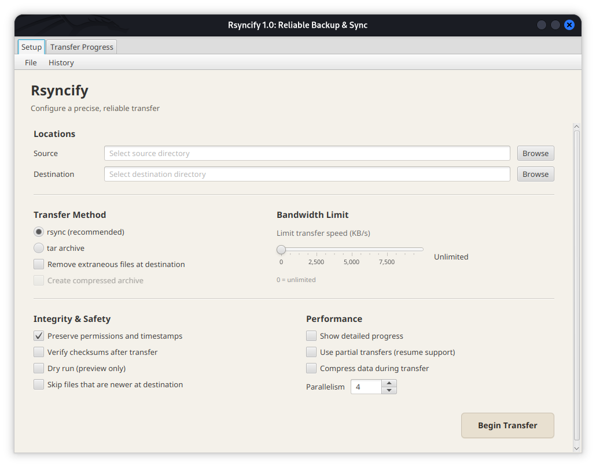

<h1 align="center">Rsyncify</h1>

<p align="center">
  <strong>A desktop front end that makes <code>rsync</code> and <code>tar</code> backups visible, previewable and hard to get wrong.</strong>
</p>

<p align="center">
  
  
  
  
  
  
</p>

---

## Table of contents

- [About](#about)
- [Features](#features)
- [Requirements](#requirements)
- [Installation and first run](#installation-and-first-run)
- [Using Rsyncify](#using-rsyncify)
- [Option reference](#option-reference)
- [Project layout](#project-layout)
- [Troubleshooting](#troubleshooting)
- [Roadmap](#roadmap)
- [Contributing](#contributing)
- [Support the project](#support-the-project)
- [License](#license)

## About

`rsync` is one of the most dependable tools ever written for copying data, but its power hides behind a wall of single-letter flags, and one misplaced `--delete` can empty a backup folder. Rsyncify puts a graphical form in front of it.

You choose a source and a destination, tick the behaviour you want, and press **Begin Transfer**. The application builds the command, runs it as a normal system process, and streams the output into a live activity log with a progress bar. Nothing is re-implemented: the actual copying is done by the `rsync` and `tar` binaries already on your machine, so you keep their speed, their delta-transfer algorithm and their long track record.

Rsyncify is built with JavaFX and Maven, targets Linux, and is currently at **version 1.0.0**.

**Who it is for**

- People who want dependable local or mounted-drive backups without memorising rsync syntax.
- Anyone who wants to rehearse a transfer with a dry run before touching real data.
- Students and tinkerers who want a small, readable JavaFX project that drives external processes.

## Features

- **Two transfer engines.** Incremental synchronisation with `rsync`, or a single archive produced with `tar`.
- **Mirror mode.** Optionally remove files from the destination that no longer exist in the source.
- **Compressed archives.** Create a compressed archive when the `tar` method is selected.
- **Bandwidth limiting.** A slider caps transfer speed in KB/s; `0` means unlimited.
- **Integrity and safety controls.** Preserve permissions and timestamps, verify checksums after the transfer, run a dry run that only previews changes, and skip files that are newer at the destination.
- **Performance controls.** Detailed progress output, resumable partial transfers, compression in transit, and an adjustable parallelism setting.
- **Live progress view.** A dedicated tab with an activity log, a percentage bar, and **Pause**, **Resume**, **Stop** and **Return to Setup** buttons.
- **History menu.** A menu entry for reviewing earlier runs.
- **Themeable interface.** The look is defined in FXML and a single CSS file (`scenebuilder.css`), so restyling needs no Java changes.

## Requirements

| Requirement | Version | Why it is needed |
|---|---|---|
| Linux (X11 or Wayland) | any current distribution | `rsync` and `tar` are invoked as system commands |
| JDK | **21** | The project is compiled and run against JavaFX 21 |
| Apache Maven | 3.8 or newer | Builds the project and downloads JavaFX automatically |
| `rsync` | 3.1 or newer recommended | Incremental transfers |
| `tar` | GNU tar | Archive mode |
| GTK 3 and OpenGL libraries | see below | Required by JavaFX to draw its window |

JavaFX itself does **not** need to be installed by hand. Maven fetches the matching JavaFX modules from Maven Central the first time you build.

## Installation and first run

### 1. Install the system packages

**Debian, Ubuntu, Kali**

```bash
sudo apt update
sudo apt install openjdk-21-jdk maven rsync tar git \
                 libgtk-3-0 libgl1 libxtst6 libxxf86vm1
```

**Fedora, RHEL, Rocky, Alma**

```bash
sudo dnf install java-21-openjdk-devel maven rsync tar git gtk3 mesa-libGL libXtst libXxf86vm
```

**Arch, Manjaro**

```bash
sudo pacman -S jdk21-openjdk maven rsync tar git gtk3
```

If your distribution does not package JDK 21 yet (for example Debian 12), install it with [SDKMAN!](https://sdkman.io/) instead:

```bash
curl -s "https://get.sdkman.io" | bash
source "$HOME/.sdkman/bin/sdkman-init.sh"
sdk install java 21-tem
```

### 2. Check your toolchain

```bash
java -version      # should report version 21.x
mvn -version       # the "Java version" line should also say 21.x
rsync --version    # should print a version banner
```

If `mvn -version` reports a different Java than `java -version`, point Maven at JDK 21 by exporting `JAVA_HOME` before continuing:

```bash
export JAVA_HOME="$(dirname "$(dirname "$(readlink -f "$(command -v javac)")")")"
```

### 3. Get the code and run it

```bash
git clone https://github.com/Demgainschill/Rsyncify.git
cd Rsyncify
mvn clean javafx:run
```

The first run downloads dependencies and can take a minute or two. Later runs start in seconds. The Rsyncify window opens on the **Setup** tab.

### Other platforms

- **macOS:** install with `brew install openjdk@21 maven rsync`. The `rsync` bundled with macOS is very old, so the Homebrew one is strongly recommended. This platform is untested for v1.
- **Windows:** not supported natively because `rsync` and `tar` are expected on the system path. Use WSL 2 with WSLg and follow the Debian or Ubuntu steps.

## Using Rsyncify

1. **Pick the source.** Type a path or press **Browse**. A folder is copied as a whole.
2. **Pick the destination.** Choose the directory the backup should land in.
3. **Choose a transfer method.** Use *rsync* for incremental syncing, or *tar archive* for a single bundled file.
4. **Tick your options.** Start conservative: leave *Remove extraneous files* off and tick *Dry run*.
5. **Press Begin Transfer.** The window switches to **Transfer Progress** and the log begins to fill.
6. **Review the preview.** If the dry run lists exactly what you expected, press **Return to Setup**, untick *Dry run* and run it for real.

> **Safety tip:** *Remove extraneous files at destination* makes the destination an exact mirror of the source. Anything in the destination that is not in the source is deleted. Always run a dry run first when this option is on.

## Option reference

The right-hand column shows the standard command-line concept each control corresponds to, which is handy if you want to reproduce a run in a terminal.

| Control | What it does | rsync concept |
|---|---|---|
| rsync (recommended) | Incremental copy, only changed data is sent | `rsync` |
| tar archive | Bundles the source into one archive file | `tar` |
| Remove extraneous files at destination | Deletes destination files missing from the source | `--delete` |
| Create compressed archive | Compresses the archive (tar method only) | `tar -z` |
| Limit transfer speed (KB/s) | Caps throughput, `0` is unlimited | `--bwlimit` |
| Preserve permissions and timestamps | Keeps modes and modification times | `-p -t` (part of `-a`) |
| Verify checksums after transfer | Compares content hashes, not just size and time | `--checksum` |
| Dry run (preview only) | Lists what would change, writes nothing | `--dry-run` |
| Skip files newer at destination | Never overwrites a newer destination file | `--update` |
| Show detailed progress | Prints per-file and overall progress | `--progress` |
| Use partial transfers (resume support) | Keeps half-copied files so they can resume | `--partial` |
| Compress data during transfer | Compresses data on the wire | `-z` |
| Parallelism | Number of concurrent workers | n/a |

## Project layout

```text
rsyncify/
├── pom.xml                         Maven build, JavaFX dependencies, run plugin
├── scenebuilder.css                Application stylesheet
├── LICENSE
├── scripts/
│   └── update_donation_address.py  Helper that updates the donation block below
└── src/main/
    ├── java/
    │   ├── module-info.java        Java module descriptor
    │   └── com/rsyncify/
    │       ├── App.java            JavaFX entry point, loads the first scene
    │       ├── BackupController.java  UI logic, builds and runs the transfer
    │       └── SystemInfo.java     Environment and system helpers
    └── resources/
        ├── backup-main.fxml        Setup tab
        └── backup-progress.fxml    Transfer Progress tab
```

## Troubleshooting

**`WARNING: Loading FXML document with JavaFX API of version 27.x by JavaFX runtime of version 21.x`**
Harmless. An FXML file was last saved by a newer Scene Builder than the JavaFX runtime in use. To silence it, align the version declared in the FXML files with the runtime:

```bash
sed -i 's#xmlns="http://javafx.com/javafx/[0-9.]*"#xmlns="http://javafx.com/javafx/21"#' src/main/resources/*.fxml
```

**`Error: JavaFX runtime components are missing`**
You launched the class or jar directly with `java`. Always start the application with `mvn javafx:run` so Maven puts JavaFX on the module path.

**`release version 21 not supported` or `invalid target release`**
Maven is using an older JDK. Re-check `mvn -version` and set `JAVA_HOME` as shown above.

**`rsync: command not found` or `tar: command not found`**
Install them with your package manager (see the installation section).

**The window does not appear, or shows `Unable to open DISPLAY`**
You are on a headless or SSH session. Use a desktop session, or forward a display. Under some virtual machines, forcing software rendering helps: `mvn javafx:run -Dprism.order=sw`.

**Permission denied during a transfer**
The user running Rsyncify cannot read the source or write to the destination. Run it as a user with the right access rather than defaulting to root.

**Dependency download fails**
Check that you can reach `repo.maven.apache.org`. Behind a proxy, configure it in `~/.m2/settings.xml`.

## Roadmap

- [ ] Standalone installers and a bundled runtime (`jlink` / `jpackage`)
- [ ] Saved backup profiles
- [ ] Scheduled and recurring jobs
- [ ] Remote destinations over SSH
- [ ] Exclude patterns
- [ ] Persistent, searchable history

## Contributing

Bug reports, ideas and pull requests are welcome.

1. Fork the repository and create a branch: `git checkout -b feature/my-change`
2. Make your change and confirm `mvn clean javafx:run` still starts cleanly.
3. Commit with a clear message and open a pull request describing what changed and why.

When reporting a bug, please include your distribution, the output of `java -version` and `rsync --version`, and the text of the activity log.

## Support the project

Rsyncify is free. If it saved you time, a tip is appreciated but never expected.

<!-- donate:start -->
_No donation address has been configured yet._
<!-- donate:end -->

## License

Released under the [MIT License](LICENSE).
